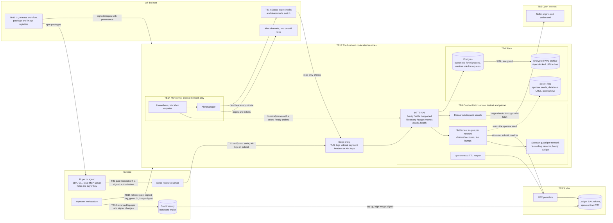

This diagram shows a Rail402 deployment as the [threat model](/security/threat-model) describes it. Every
dashed group is a trust boundary from the threat model's [boundary table](/security/threat-model#trust-boundaries),
and every arrow is a flow that crosses one or stays inside one. A component is added here in the same change
that adds its threats to the registry.

## What crosses each boundary

| Boundary                              | Flows                                                 | Controls (see the threat model for each)                                   |
| ------------------------------------- | ----------------------------------------------------- | -------------------------------------------------------------------------- |
| TB1 Buyer and seller                  | The paid request and the payer's signed authorization | Signatures bind recipient, asset, amount or cap, and expiry                |
| TB2 Seller and facilitator            | `/verify`, `/settle`, discovery reads                 | Coded refusals, rate limits, API keys on pubnet                            |
| TB3 Facilitator and Stellar           | Simulation, submission, confirmation                  | Fee ceilings, recorded envelopes, landing proofs                           |
| TB4 Facilitator and its state         | Settlement ledger, catalog, secrets                   | File secrets, split database roles, encrypted backups                      |
| TB5 Facilitator and the open internet | Origin checks, `stellar.toml` fetches                 | safe-fetch: public addresses only, pinned DNS, size and time limits        |
| TB9 One service, two networks         | Shared process, database, limiter, metrics            | Per-network budgets and readiness, private metrics                         |
| TB10 Operator key custody             | Seed generation, top-ups, signer changes              | Offline generation, cold high-weight signer, reviewed transactions         |
| TB14 Monitoring and status            | Scrapes, probes, alerts, heartbeat, external checks   | Internal network only, fixed probe targets, off-host dead-man's switch     |
| TB15 Source, release and deploy       | Tags, CI, images, packages, deploys                   | CI-gated release with provenance and SBOM, signed tags, deploy gate        |
| TB17 The host and co-located services | Other tenants, the edge proxy, the host administrator | Per-app networks, no published ports, file secrets, accepted residual risk |
